# Living Boards — the whole story, with receipts

*What we built, what it feels like to use, and exactly how we did it. Every claim below has a screenshot, a test count, or a hash behind it.*

---

## (a) What Living Boards is — and the follow-along magic

**Living Boards** turns flat chat replies into **live, addressable dashboards inside the conversation**. A board has an address, can be **updated in place** (new version, old versions kept), is **linkable**, and shows up wherever you need it — instead of the chat filling up with stale copies of the same chart.

That solved one problem and created a better one: when a board updates, *where should it live?* Scattered copies are noise. So we made the board **follow the conversation**:

> **When a board is updated, it re-renders at the latest reply. Its old spot leaves a small, clickable marker — "↓ this board was updated below" — that jumps you straight to the live version.**

This is the behavior it feels like to use: *the chart pops into your newest answer, and everything else moves out of the way.*

**Before** (the complaint): the board stayed frozen at its first mention while the conversation moved on —

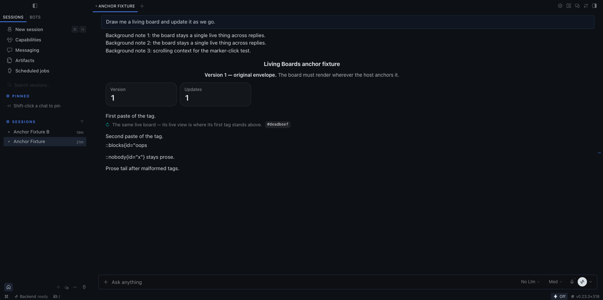

**After** (follow-along): one live card at the latest reply, quiet markers at the earlier spots —

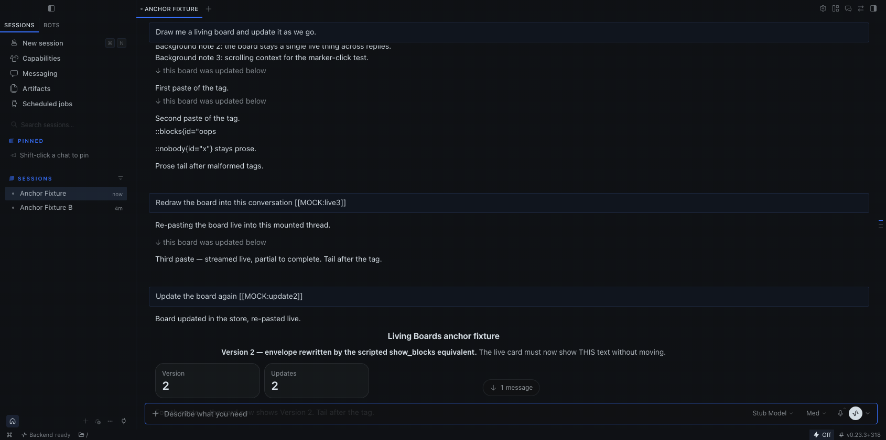

The move happens *while you watch*: mid-stream the old spot retires to a marker, the new spot shows a brief "drawing…" note, then the board settles —

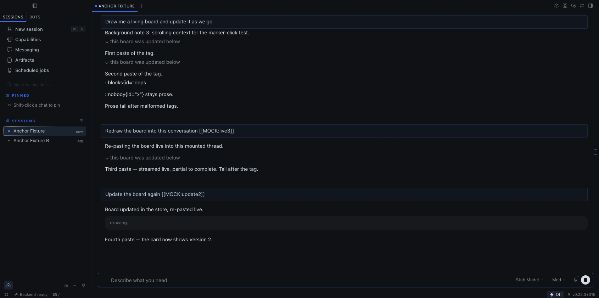

Click a marker and the live board scrolls to center:

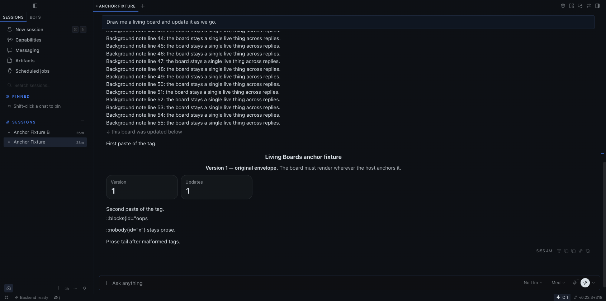

Reload the app and nothing drifts: same one card, same markers (idempotent replay) —

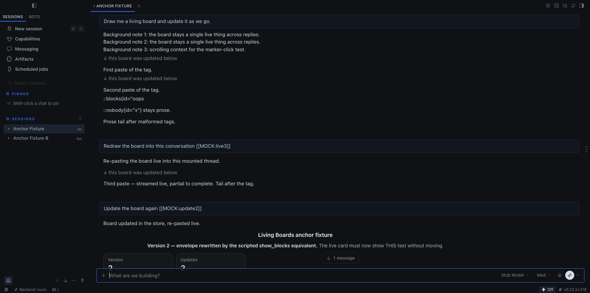

The plugin side (addressable, updatable, linkable boards, version history) is upstream **PR #55**; these before/after plugin captures are already on the PR evidence trail:

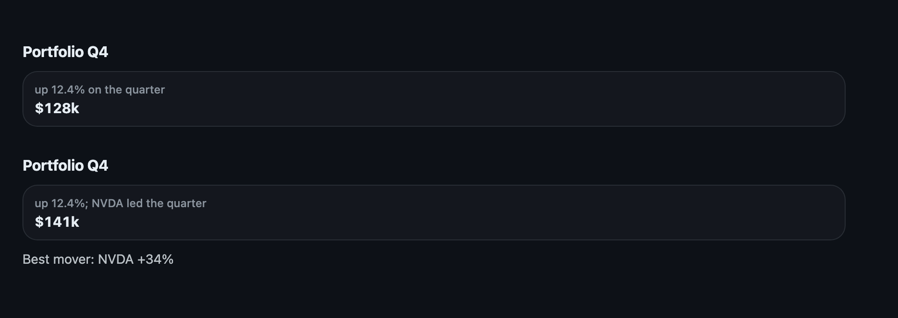
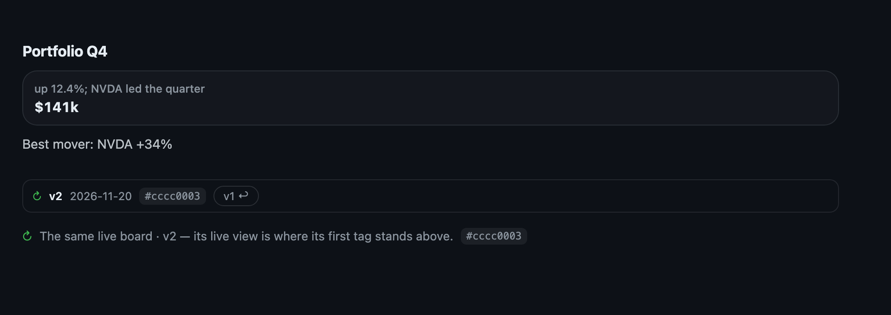
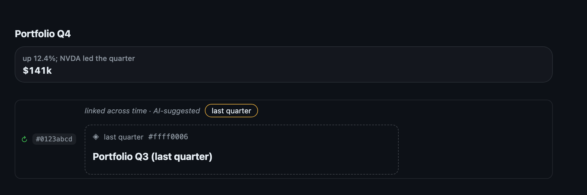
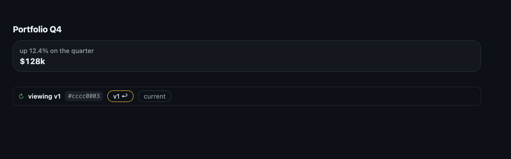

---

## (b) Answer-first layout

A board should read like an **answer**, not a pile of widgets. We moved the verdict/headline to the **top** of every dashboard, evidence underneath:

**Before** — the verdict was buried below the charts:

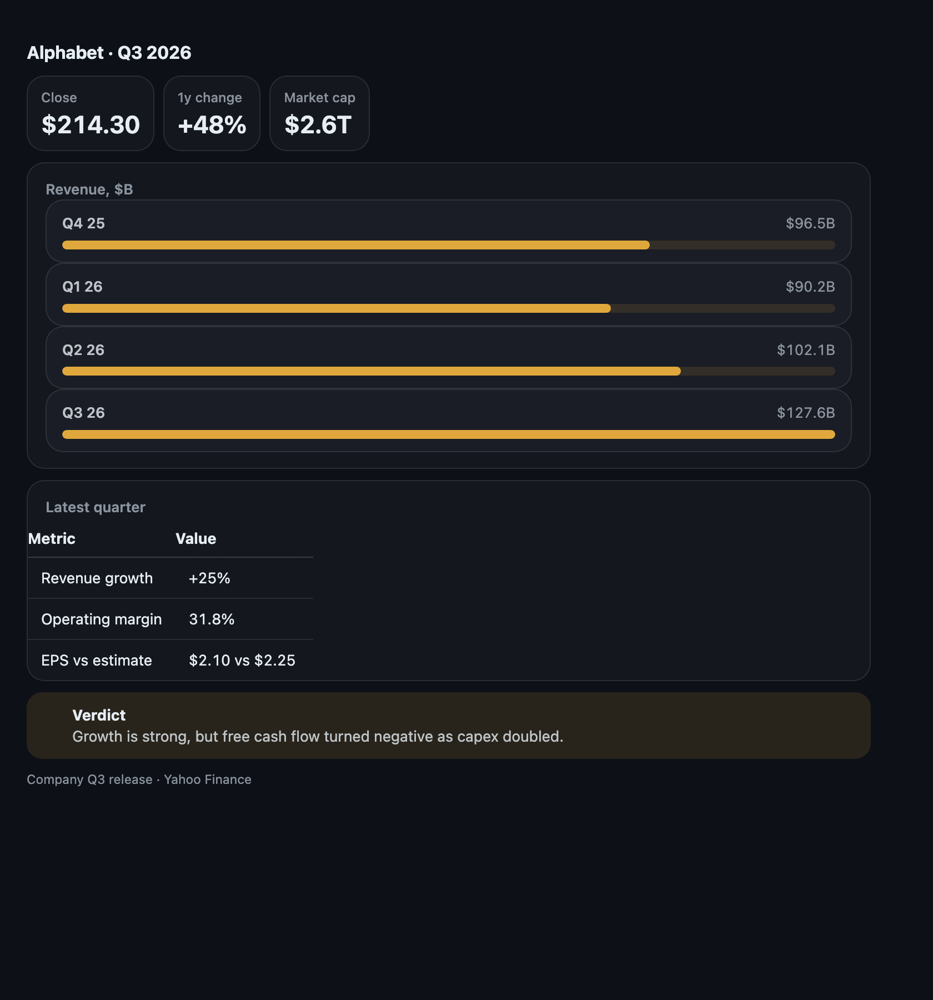

**After** — the verdict leads, the numbers support it:

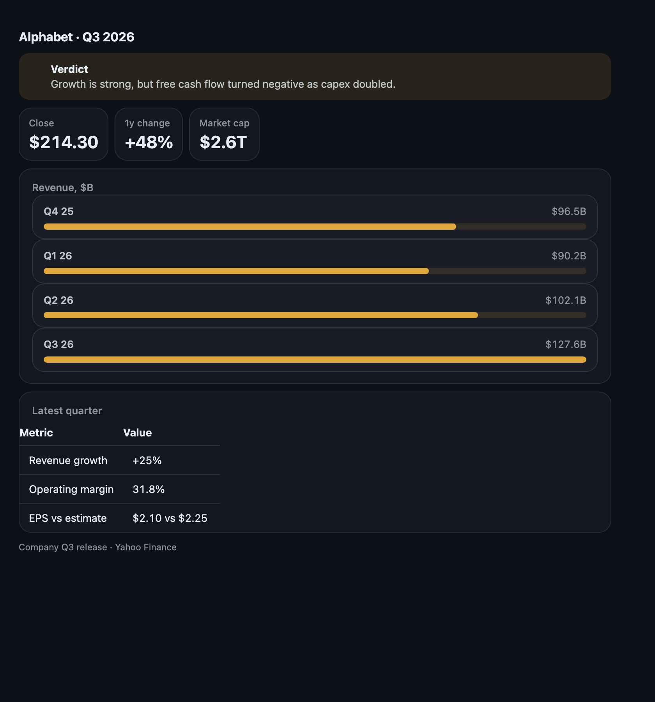

This landed upstream as **PR #57** (stock-dashboard verdict-top) and **PR #58** (judgment lines on every draw), and is applied locally too.

---

## (c) It's actually live

This is not a demo build. The follow-along change is running on the owner's Mac **right now**:

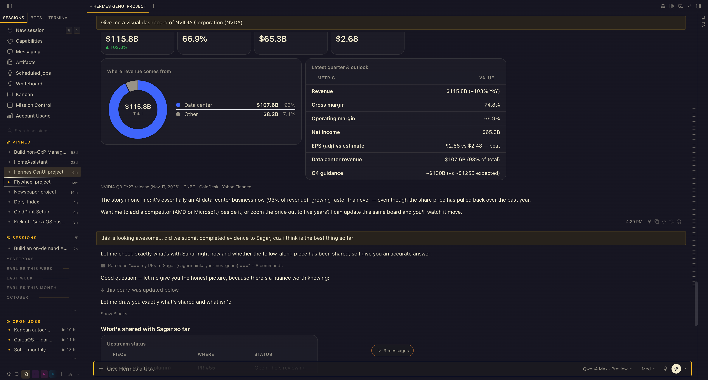

*The daily-driver Hermes desktop, the owner's real conversation: the NVIDIA Living Board rendered by the plugin, and the muted "↓ this board was updated below" follow-along marker, both live in the same session.*

Machine-checkable proof of the live install:

| Check | Result |
|---|---|
| `/Applications/Hermes.app/Contents/Resources/install-stamp.json` | `commit == 91d815b1`, `branch == living-boards-anchor`, `dirty == false` |
| Marker string in the live bundle | `↓ this board was updated below` present in `dist/assets/capabilities-BzGTYnHU.js` |
| Rollback safety net | byte-exact backup `~/.hermes/backups/Hermes.app.20261121T125251` (1,386 files) |
| Owner experience | the follow-along demo (a board drawn, then updated, visibly moving to the newest reply) was run live in the owner's own session and is still in that transcript |

---

## (d) How we did it

The process is part of the product story. Five gates, in order:

1. **Sandbox-gated build.** The host change was built and tested in an *isolated second instance* of the app — its own home directory, its own private gateway, a scripted offline model (zero real LLM calls, zero reuse of the owner's credentials), running side-by-side with the owner's untouched live app. Every screenshot passed a hard "depiction gate" (a real transcript on screen, no dialogs) before being accepted as evidence.
2. **Independent review.** A separate reviewer card audited the evidence and sent back changes — including catching a batch of screenshots that depicted the wrong screen. The rework round re-verified the frozen candidate byte-for-byte (`candidate.patch` sha256 `ef54232d…`) and re-ran the tests under fresh authority.
3. **Deterministic, byte-stamped builds.** Three independent clean builds produced **byte-identical 1,117-file distributions** — the shipped bundle is reproducible, not a one-off.
4. **Byte-exact backup + rollback drill.** Before touching the real app, the entire existing install was backed up (1,386 files, checksummed) and the rollback was *practiced*, not assumed.
5. **Owner-gated live apply.** The swap into `/Applications/Hermes.app` happened only after the owner's explicit go-ahead — and the stamp above is what shipped.

---

## (e) Evidence index

**Re-anchor (Hermes app host change)**
- Focused tests: **43/43** (RED-first: 9 behavioral tests failed pre-implementation)
- Full UI suite on frozen bytes: 1,659 files / 14,273 tests / 0 failures; evidence manifest **104/104**
- Three byte-identical builds (1,117 files each); evidence archive sha256 `86c38d0f…`
- Captures (all verified to depict real transcripts): base repro, static collapse, streaming phases (tag window → drawing placeholder → settled v2), marker click, reload idempotency

**Answer-first (upstream)**
- Upstream suite: **1,148 passed** (base 1,147 + exactly the new guard); local stack: **985 passed**
- Verdict position measured in-browser: buried (591px) → top (36px); byte-reproducible renders

**Living Boards plugin (PR #55)**
- Duplicate-board / update-pointer / board-link / v1 reach-back captures hosted and returning HTTP 200

**Live apply**
- Stamp `91d815b1` on `living-boards-anchor`; marker string present in the live bundle; 1,386-file byte-exact backup with practiced rollback

---

## (f) Where to find it

- **PR #55** — Living Boards plugin (addressable, updatable, linkable boards + version history)
- **PR #54** — companion upstream work
- **PR #57** — stock-dashboard verdict-top (answer-first)
- **PR #58** — judgment lines on every draw (answer-first)
- Repo: `sagarmainkar/hermes-genui` · fork with this showcase: `leosgarza/hermes-genui`

---

### Capture provenance (honesty note)

- **Live captures:** `live-app-nvidia-board-and-marker.png` is a screenshot of the *running* Hermes desktop app on the owner's Mac (install stamp `91d815b1`), showing the owner's real conversation.
- **Sandbox captures:** the `sandbox-*.png` series comes from the isolated second app instance (fixture transcripts, offline stub model, no owner data). They are used to show the *ordered journey* (before → streaming → settled → click → reload) deterministically.
- **Answer-first captures:** rendered from the repo's own recipe example with the shipped CSS, byte-reproducible.

**Known edge (being polished):** in very long conversations, scrolling back up can occasionally re-show an earlier copy of a board instead of the latest. Normal use, short threads, and live updates follow along exactly as shown above.
